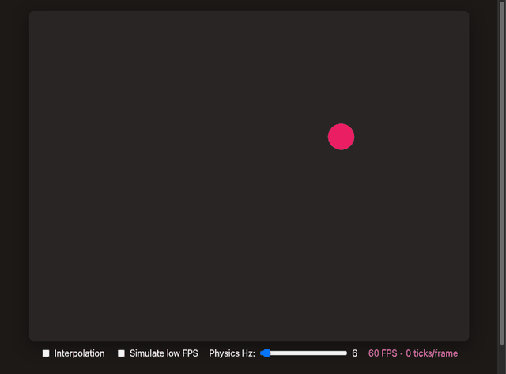

# Physics with a Metronome — Fixed Timestep + Render Interpolation

[](https://m2-md.github.io/fixed-timestep-render-interpolation/)
[](https://javascript.plainenglish.io/metronome-physics-fixed-timestep-game-loops-and-render-interpolation-in-typescript-cdf54ec5ea11?source=friends_link&sk=ff5390a11e2d97b29e82dc41a6572272)
[](https://www.buymeacoffee.com/mkare/e/599265)
[](./tsconfig.json)



> Deterministic fixed timestep physics simulation decoupled from variable display refresh rates using state accumulator and alpha render interpolation in TypeScript.

## 2D Canvas & Game Physics Series

| Part | Topic | Live Demo | Free Guide (Friend Link) |
| :--- | :--- | :--- | :--- |
| **Part 1** | **2D Rigid-Body Physics & Slingshot** | [▶ Play Demo](https://m2-md.github.io/canvas-physics-from-scratch/) | [📖 Read Free](https://javascript.plainenglish.io/how-game-physics-works-building-a-2d-physics-engine-from-scratch-in-canvas-5cd26416ddb8?source=friends_link&sk=f9c8048fe5b2d513b3c0d26127e97fb4) |
| **Part 2** | **HiDPI Canvas & `devicePixelRatio`** | [▶ Live Comparison](https://m2-md.github.io/hidpi-canvas-devicepixelratio/) | [📖 Read Free](https://javascript.plainenglish.io/why-does-canvas-look-blurry-on-retina-displays-devicepixelratio-and-the-tale-of-two-sizes-2be8f6e6f7f8?source=friends_link&sk=3c3af29a65f3d3238efd567f24c20b00) |
| **Part 3** | **Fixed Timestep & Render Interpolation** *(this repo)* | [▶ Live Metronome](https://m2-md.github.io/fixed-timestep-render-interpolation/) | [📖 Read Free](https://javascript.plainenglish.io/metronome-physics-fixed-timestep-game-loops-and-render-interpolation-in-typescript-cdf54ec5ea11?source=friends_link&sk=ff5390a11e2d97b29e82dc41a6572272) |
| **Part 4** | **Object Pools & Zero-Allocation Loops** | [▶ Pooled vs Unpooled](https://m2-md.github.io/object-pools-zero-allocation/) | [📖 Read Free](https://medium.com/@mkare/return-the-cart-clear-the-exit-object-pools-and-zero-allocation-loops-in-canvas-4051c97ff8a7?source=friends_link&sk=2ed006e6c639a47b92eb324d11a664a6) |

> 📦 **Want the bundled TypeScript Starter Kit + cheatsheets?** Grab the [TS 2D Canvas Physics & HiDPI Starter Kit](https://www.buymeacoffee.com/mkare/e/599265) (or unlock it free with a [Buy Me a Coffee membership](https://www.buymeacoffee.com/mkare)).

Working code for the article "Physics with a Metronome: Fixed-Timestep Game Loop
and Render Interpolation in TypeScript". It upgrades a variable-dt physics loop
into a deterministic **fixed timestep** loop that produces byte-for-byte identical
results on every machine, then decouples drawing from physics and **interpolates**
between two ticks.

What's inside:

1. **Mini physics engine** (`src/world.ts`) — semi-implicit Euler + wall bounce.
   `Body` gains a `prev` field for interpolation, and `World` gains `snapshot()`,
   which is called before each step.
2. **Accumulator loop** (`src/sim.ts`) — accumulates real time and steps in fixed
   `STEP` slices; includes death-spiral protection (`maxFrame` clamping + `maxSteps`
   ceiling + debt clearing) and the `alpha = acc / STEP` interpolation ratio.
3. **Live demo** (`src/demo.ts` + `index.html`) — bouncing ball, interpolation
   on/off, a "simulate low FPS" toggle and a "Physics Hz" slider, live FPS/tick counters.
4. **Determinism proof** (`test/sim.test.ts`) — same total time, different frame
   splits → fixed step stays byte-identical, variable dt diverges.

## Setup

```bash
npm install
```

## Running

```bash
npm run dev
```

The demo opens at `http://localhost:5173/`. It runs entirely in the browser; no
separate Node server process is needed in the background (the Vite dev server is enough).

> Do not open `index.html` with `file://` — the ES modules will not resolve and you
> will get a blank screen. The Vite dev server is required.

**What to try:** drag the "Physics Hz" slider down to 4. With interpolation **off**,
the ball teleports 4 times per second (visible jitter); **the moment you turn it on**,
the gap between those same 4 ticks is filled in at 60 FPS and the ball glides. The
physics is identical in both cases; the only thing that changed is what your eye sees.
Use "simulate low FPS" to produce a large `frameTime` and watch the accumulator drain
multiple ticks in a single frame.

## Test

```bash
npm test
```

Expected: 5 tests pass.

- **Determinism (3 asserts):** the same 10 seconds is split into 60/15/30 FPS; the
  fixed-step state (`pos`, `vel`) is `toEqual` in all three — bit identical.
- **Divergence:** the same 0.8 seconds of free fall, split into different `dt`s under
  variable dt, gives `not.toEqual` — semi-implicit Euler's dependence on `dt`.
- **Interpolation math (3 tests):** `lerp` at `t=0`, `t=1`, `t=0.5`.

## Bench

```bash
npm run bench
```

A deterministic measurement (no browser, `vite-node`): it feeds the same 10 seconds
through three FPS scenarios. Sample output:

```
FIXED STEP (accumulator) — same total duration, three frame splits:
  60 FPS (600x)    pos=(  393.120000,  580.000000)  vel=(  140.800000,   -6.666667)
  15 FPS (150x4)   pos=(  393.120000,  580.000000)  vel=(  140.800000,   -6.666667)
  30 FPS (300x2)   pos=(  393.120000,  580.000000)  vel=(  140.800000,   -6.666667)
  -> max |Δpos| = (0, 0)  EXACTLY IDENTICAL

VARIABLE dt (old loop) — same total duration, two frame splits:
  60 FPS (600x)    pos=(  393.120000,  580.000000)  vel=(  140.800000,   -6.666667)
  15 FPS (150x4)   pos=(  386.080000,  580.000000)  vel=(  140.800000,  -26.666387)
  -> |Δpos| = (7.0400, 0.0000)  DIVERGED

Summary: fixed step diverges 0 px, variable dt diverges 7.0 px (same 10 s).
```

## Build

```bash
npm run build
```

`tsc` (type check, `noEmit`) + `vite build` (production build). Both must pass
without errors.

## File layout

```
src/
  vec.ts        # Vec2 + vec/add/scale + lerp (interpolation)
  world.ts      # Body (prev), createBody, World.snapshot/step/collideWalls
  sim.ts        # Accumulator (with EPS), runFixed, runVariable
  demo.ts       # Browser demo: rAF loop + controls + HUD
  bench-cli.ts  # Deterministic bench (vite-node)
test/
  sim.test.ts   # Determinism + divergence + lerp tests
index.html      # Canvas + controls
```

## License

MIT
